# protorecprep – Software-Design-Dokument (arc42)

| Feld | Wert |
|------|------|
| Projekt | `protorecprep` |
| Dokumenttyp | Software-Design-Dokument nach arc42 |
| Version | 1.0 |
| Stand | 10. November 2026 |
| Git-Stand | `ce84dde` (plus lokale Dokumentation) |
| Zielgruppe | Entwickler, Betreiber, Integratoren |
| Sprache | Deutsch |

Dieses Dokument beschreibt die Architektur von `protorecprep`. Es folgt der
Kapitelstruktur von arc42 und ergänzt die benutzerorientierte
[`README.md`](../README.md) sowie die Docker-Hinweise in
[`docker.md`](docker.md). Alle Aussagen beziehen sich auf den oben genannten
Code-Stand.

## Inhaltsverzeichnis

1. [Einführung und Ziele](#1-einführung-und-ziele)
2. [Randbedingungen](#2-randbedingungen)
3. [Kontextabgrenzung](#3-kontextabgrenzung)
4. [Lösungsstrategie](#4-lösungsstrategie)
5. [Bausteine](#5-bausteine)
6. [Laufzeit](#6-laufzeit)
7. [Verteilung](#7-verteilung)
8. [Querschnittliche Konzepte](#8-querschnittliche-konzepte)
9. [Architekturentscheidungen](#9-architekturentscheidungen)
10. [Qualitätsanforderungen](#10-qualitätsanforderungen)
11. [Risiken und technische Schulden](#11-risiken-und-technische-schulden)
12. [Glossar](#12-glossar)

---

## 1. Einführung und Ziele

### 1.1 Zweck des Systems

`protorecprep` ist ein protokolltransparenter TCP-Recorder und -Replayer für
Protobuf-Datenströme. Das System nimmt Verbindungen an, schreibt jedes
empfangene Byte in ein eigenes, versioniertes Capture-Format und kann diese
Aufzeichnung später byte-genau an einen anderen Server zurückspielen.
Optional entsteht parallel ein JSONL-Sidecar mit dekodierten
Protobuf-Nachrichten und extrahierten Datei-/Blob-Kanälen.

Der zentrale Qualitätsanspruch lautet: **Die Binäraufnahme ist die
maßgebliche Wahrheit.** Sie muss auch dann vollständig und replizierbar sein,
wenn das JSON-Sidecar Fehler macht, Frames unbekannt sind oder der
Anwendungsprozess abstürzt.

### 1.2 Funktionale Anforderungen

| ID | Anforderung | Ausprägung im System |
|----|-------------|----------------------|
| FR-01 | TCP-Server mit mehreren parallelen Verbindungen | `Server`, `Session`, Boost.Asio mit Session-Strands |
| FR-02 | Verlustfreie Binäraufnahme inkl. Wire-Framing | `Recorder`, `CaptureItem`, `.pcr`-Format |
| FR-03 | Drei Framings: `varint-length`, `raw`, `typed-length-le` | `rec::Framing`, `FrameValidator`, `FrameReader` |
| FR-04 | 8-Byte-Header: 4 Byte Typ-ID LE + 4 Byte Länge LE | `kTypedHeaderSize`, `frame_typed_message()` |
| FR-05 | Typzuordnung ausschließlich über `type_map` | CLI/INI-Parser, `resolve_type_map()` |
| FR-06 | Unbekannte Typ-IDs ohne Verbindungsabbruch erfassen | `JsonWriter::handle_data()` → `unparsed` mit `type_id` |
| FR-07 | Datei-/Blob-Kanäle über `@file`/`@blob` | `options.file_types`, `JsonWriter::emit_blob()` |
| FR-08 | Byte-genaues Replay, optional mit Echtzeit-Pacing | `ReplayRunner`, `CaptureReader`, `ClientConnection` |
| FR-09 | Live-Weiterleitung mit gleichzeitiger Aufzeichnung | `SessionForwarder`, Passthrough-Modus |
| FR-10 | Chunking nach Größe und/oder Zeit | `Recorder::maybe_rotate()` |
| FR-11 | Crash-Erkennung und Reparatur | Trailer, CRC32C, `inspect --truncate` |
| FR-12 | Lesbares JSONL-Sidecar mit Fehlerdiagnose, je Capture-Chunk eine Datei | `JsonWriter`, `capture-NNNNNN.jsonl` |
| FR-13 | Ausgehende Nachrichten an Clients | `SendSpec`, Timer, `frame_message()`/`frame_typed_message()` |
| FR-14 | Betrieb im Container ohne Host-Abhängigkeiten | `Dockerfile`, `compose.yaml`, `etc/docker.ini` |
| FR-15 | Schema-Validierung beim Replay | SHA-256 im Datei-Header, `ReplayRunner::validate_schema()` |
| FR-16 | Optionale Kopplung von Client- und Zielverbindung im Passthrough | `--link-connections`, `CloseReason::ForwardError` |

### 1.3 Qualitätsziele

| Priorität | Qualitätsziel | Konkretisierung |
|-----------|---------------|-----------------|
| 1 | **Integrität und Treue** | Jedes empfangene Byte wird unverändert gespeichert; Replay erzeugt denselben Bytestrom. |
| 2 | **Robustheit** | Protokollfehler, unbekannte Typen, JSON-Fehler oder Forwarding-Ausfälle dürfen die Binäraufnahme nicht zerstören. |
| 3 | **Nachvollziehbarkeit** | Jede Session besitzt Metadaten, Statistik, CRC-gesicherte Datensätze und ein lesbares Sidecar. |
| 4 | **Betreibbarkeit** | Ein Kommando, klare Exit-Codes, Docker/Compose, sauberes Shutdown auf `SIGINT`/`SIGTERM`. |
| 5 | **Durchsatz** | Wenige Kopien auf dem heißen Pfad, Batch-Schreiben, entkoppelter JSON-Worker. |
| 6 | **Wartbarkeit** | Klare Modulgrenzen, wenige Abhängigkeiten, keine externen Laufzeitdienste. |

### 1.4 Stakeholder

| Stakeholder | Interesse |
|-------------|-----------|
| Betreiber | Aufzeichnung stabil starten/stoppen, Daten im Container finden, Health über Logs/Statistik |
| Entwickler | Verständliche Bausteine, reproduzierbare Tests, klare Erweiterungspunkte |
| Protokoll-Integrator | Typ-IDs, Blob-Kanäle und Schema korrekt konfigurieren |
| Analyse/Support | JSONL, Blob-Dateien, `meta.json`, `summary.json`, `inspect` |
| QA | Byte-genaues Replay, Fehlerfälle, reproduzierbare Testdaten |

---

## 2. Randbedingungen

### 2.1 Technische Randbedingungen

| ID | Randbedingung | Konsequenz |
|----|---------------|------------|
| TB-01 | C++20, CMake ≥ 3.20 | Einheitlicher Build unter macOS und Linux |
| TB-02 | Boost.Asio ≥ 1.80 | Asynchrones I/O, Timer, Signal-Set, Strands |
| TB-03 | Protobuf mit `google/protobuf/json/json.h` | Ubuntu-24.04-Pakete (3.21) reichen nicht; Docker baut aus Quellcode |
| TB-04 | Abseil als Protobuf-Laufzeitabhängigkeit | Im Image enthalten, lokal über Homebrew/System |
| TB-05 | POSIX-Datei-I/O (`open`, `write`, `fsync`, `ftruncate`) | Kein Windows-Support; `F_FULLFSYNC` nur auf macOS |
| TB-06 | Dateisystem als einziger Persistenzspeicher | Keine Datenbank, kein externer Broker |
| TB-07 | Protokoll ist wire-kompatibel festgelegt | Keine Heuristik, keine automatische Typ-Erkennung |
| TB-08 | Container-Host hat nur Docker + Compose | Protobuf, Protoc und Abseil müssen im Image liegen |

### 2.2 Organisatorische Randbedingungen

- Das Repository enthält kein Lizenz- oder Support-Modell; Nutzung ist mit dem
  Autor abzustimmen.
- Die Dokumentation ist auf Deutsch; Code, Logs und JSON-Felder sind englisch.
- Reale Referenzdaten (`tests/events.jsonl`) sind versioniert und dienen als
  Regressionsbasis für Blob-Verarbeitung.
- Externe Zielsysteme für Replay/Passthrough liegen außerhalb des Projekts und
  werden über `host:port` erreicht.

### 2.3 Konventionen

- Fehlermeldungen verwenden `error: <text>` auf stderr.
- Exit-Codes: `0` Erfolg, `1` Laufzeitfehler, `2` Konfigurations-/Validierungsfehler.
- JSONL ist zeilenorientiert; jede Zeile ist ein vollständiges JSON-Objekt.
- Zeitstempel im Capture sind Wall-Clock-Nanosekunden; Pacing nutzt monotone Zeit.
- Öffentliche CLI-Optionen sind Langoptionen; INI-Schlüssel sind dieselben Namen
  ohne führende `--`, `-` und `_` sind austauschbar.

---

## 3. Kontextabgrenzung

### 3.1 Fachlicher Kontext

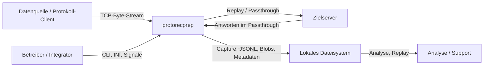

`protorecprep` sitzt zwischen Datenquelle und – im Passthrough – Zielserver.
Es interpretiert das Anwendungsprotokoll nur so weit, wie es für Framing,
Typzuordnung, JSON-Dekodierung und Blob-Extraktion nötig ist. Die
Binäraufnahme bleibt protokolltransparent.

### 3.2 Technischer Kontext

| Nachbar | Schnittstelle | Richtung | Beschreibung |
|---------|---------------|----------|--------------|
| Protokoll-Client | TCP, wählbares Framing | eingehend | Beliebige Bytes; im Typed-Framing 8-Byte-Header pro Frame |
| Zielserver | TCP | ausgehend | Replay sendet aufgezeichnete Bytes; Passthrough leitet live weiter |
| Protobuf-Schema | `.proto`-Datei (+ Importpfade) | Eingabe | Wird zur Laufzeit über libprotoc geladen |
| Dateisystem | Dateien/Verzeichnisse | Ein-/Ausgabe | Captures, JSONL, Blobs, Meta-/Summary-Dateien |
| Docker Engine | Container, Ports, Volumes | Betrieb | Image enthält App und Laufzeitbibliotheken |
| Betriebssystem | Signale, Timer, Sockets | Laufzeit | `SIGINT`/`SIGTERM` lösen sauberes Shutdown aus |

### 3.3 Externe Schnittstellen im Detail

#### Kommandozeile

```text
protorecprep <record|replay|passthrough|inspect> [Optionen]
protorecprep --help
protorecprep --version
```

Die vollständige Optionsreferenz steht in der [`README.md`](../README.md).
Konfigurationsdateien werden über `--config` geladen; explizite CLI-Werte
überschreiben INI-Werte.

#### Wire-Protokoll `typed-length-le`

| Offset | Größe | Feld |
|--------|-------|------|
| 0 | 4 | Typ-ID, Little-Endian `uint32` |
| 4 | 4 | Payload-Länge, Little-Endian `uint32`, ohne Header |
| 8 | n | Payload (Protobuf-Nachricht oder Blob) |

Die Typ-ID `0` ist im Referenzprotokoll `VersionInformation`, wird aber nicht
hart codiert. Jede Zuordnung erfolgt über `type_map`.

#### Capture-Datei `.pcr`

Siehe Abschnitt [8.5](#85-persistenz-und-datenintegrität) und
[README.md](../README.md#capture-format-pcr).

#### Umgebungsvariablen (Docker)

| Variable | Default | Wirkung |
|----------|---------|---------|
| `UBUNTU_VERSION` | `24.04` | Basis-Image |
| `ABSEIL_VERSION` | `20250512.1` | Im Image gebaute Abseil-Version |
| `PROTOBUF_VERSION` | `36.2` | Im Image gebaute Protobuf-Version |
| `PRP_PORT` | `5000` | Veröffentlichter Host-Port |

---

## 4. Lösungsstrategie

### 4.1 Architekturüberblick

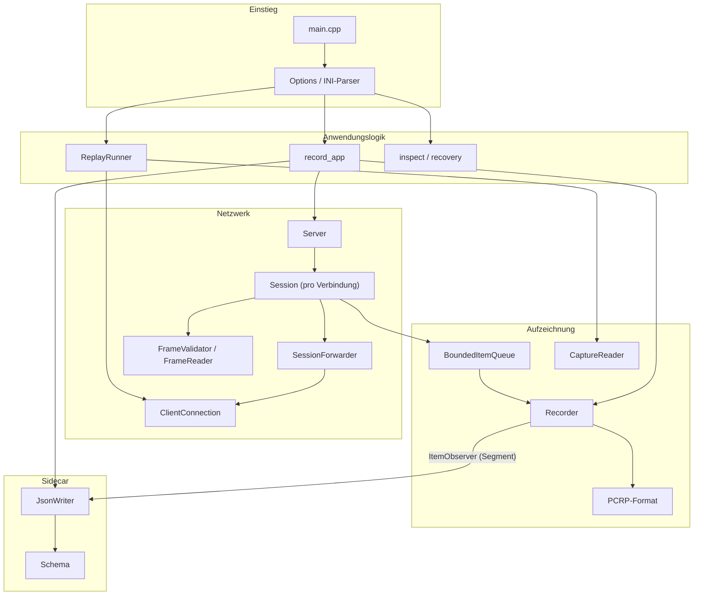

### 4.2 Zentrale Strategien

| ID | Strategie | Begründung | Umsetzung |
|----|-----------|------------|-----------|
| S1 | **Capture first** | Auch protokollwidrige Bytes müssen erhalten bleiben | `Session::on_read()` reicht Daten vor der Framing-Validierung an den Recorder |
| S2 | **Unveränderliche Arbeitseinheiten** | Mehrere Consumer ohne Kopie und ohne Sperren | `CaptureItem` als `shared_ptr`, `BoundedItemQueue` |
| S3 | **Single-Writer-Prinzip** | Keine parallelen Schreibzugriffe, deterministische Dateien | Nur der Recorder-Thread berührt `fd_`, Batch und Rotation |
| S4 | **Bounded Queues + Backpressure** | Speicher ist endlich, TCP kann bremsen | Block/Drop/Disconnect; JSON-Queue verwirft und markiert Stream als desynchronisiert |
| S5 | **Binärformat als Wahrheit** | JSON ist Komfort, nicht Autorität | JSON-Fehler werden gezählt, brechen die Aufnahme aber nicht ab |
| S6 | **Explizite Typ-Map** | Keine falschen Interpretationen durch Raten | Nur manuell konfigurierte IDs; unbekannte IDs werden `unparsed` |
| S7 | **Blob-Kanäle statt Base64** | Große Dateien würden JSON unbrauchbar machen | `@file` schreibt atomar nach `<session>/files`; JSON enthält Metadaten |
| S8 | **Eigenes, versioniertes Capture-Format** | pcap passt nicht zu beliebigen Protobuf-Strömen | PCRP mit Magic, Version, Schema-Digest, CRC32C und Trailer |
| S9 | **Zeitgetreues Replay mit Rückstau-Schutz** | Echtzeitverhalten testen, ohne Bursts zu erzeugen | Monotone Timeline, `--speed`, `--max-gap`, High-Water-Marks |
| S10 | **Forwarding ist optional und isoliert** | Passthrough darf Aufzeichnung nie gefährden | `SessionForwarder` mit eigenen Fehler-Callbacks; Source-Stream bleibt offen |
| S11 | **JSON-Chunks folgen den Capture-Chunks** | Ohne gemeinsame Grenzen ist die Zuordnung nur über Zeitstempel möglich | Recorder meldet Item + Segmentindex per Observer; Dateinamen teilen den Stamm |
| S11 | **Konfiguration vor Laufzeit prüfen** | Fehler früh und klar melden | `validate_options()` vor dem Start; Exit-Code 2 |
| S12 | **Betrieb als einzelnes Binary** | Einfacher Transport und Containerbetrieb | Keine externen Dienste; nur Dateisystem und TCP |

### 4.3 Technologieentscheidungen im Überblick

- **Boost.Asio** für alle Socket-, Timer- und Signaloperationen.
- **libprotoc `Importer`** zum Laufzeitladen des Schemas; kein Codegenerator
  im Build nötig.
- **`DynamicMessageFactory`** pro Consumer-Thread, da Protobuf-Nachrichten
  nicht thread-sicher geteilt werden.
- **SHA-256** für den Schema-Digest, **CRC32C** für Datensatzintegrität.
- **Eigenes JSONL** statt eingebetteter Datenbank, damit Aufzeichnungen mit
  Standardwerkzeugen lesbar bleiben.
- **Docker Multi-Stage-Build**: Abseil und Protobuf werden aus gepinnten
  Quellen gebaut; das Laufzeit-Image enthält nur die nötigen Bibliotheken.

---

## 5. Bausteine

### 5.1 Bausteinübersicht (Ebene 1)

| Baustein | Verantwortung | Quellorte |
|----------|---------------|-----------|
| Einstieg/CLI | Argumente, INI, Hilfe, Validierung, Dispatch | `src/main.cpp`, `src/prp/cli/` |
| Anwendungssteuerung | Start-/Shutdown-Reihenfolge, Metadaten, Summary, Inspect | `src/prp/app/record_app.cpp` |
| Netzwerk-Server | Accept, Verbindungslimit, Session-Lebenszyklus | `src/prp/net/server.cpp`, `server.h` |
| Framer | Inkrementelle Validierung und Reassembly | `src/prp/net/framer.cpp`, `framer.h` |
| Recorder | Persistenz, CRC, Rotation, fsync, Statistik | `src/prp/record/recorder.cpp`, `recorder.h` |
| Capture-Format | Header-/Record-Kodierung und -Dekodierung | `src/prp/record/format.cpp`, `format.h` |
| Capture-Reader | Sequenzielles Lesen, Scan, Recovery | `src/prp/record/reader.cpp`, `reader.h` |
| JSON-Sidecar | Dekodierung, Blob-Extraktion, JSONL-Chunks je Capture-Chunk | `src/prp/json/json_writer.cpp`, `json_writer.h` |
| Schema | `.proto` laden, Descriptor-Set, Digest | `src/prp/proto/schema.cpp`, `schema.h` |
| Core | Items, Richtungen, Close-Gründe, Queue | `src/prp/core/` |
| Forwarding/Client | Asynchroner TCP-Client und Weiterleitung | `src/prp/net/client.cpp`, `forwarder.cpp` |
| Replay | Timeline, Pacing, Reconnect, Validierung | `src/prp/replay/replay_app.cpp` |
| Utilities | Log, CRC32C, SHA-256, Base64, FS, Text | `src/prp/util/` |
| Deployment | Image, Compose, Beispielkonfigurationen | `Dockerfile`, `compose.yaml`, `etc/` |
| Tests/Benchmark | Unit-, Integrations-, E2E-Tests, Durchsatz | `tests/`, `bench/` |

### 5.2 Ebene 2 – Module und ihre Zusammenarbeit

#### 5.2.1 Einstieg und CLI

`main()` parst zuerst die Optionen. Bei Fehlern wird die Hilfe ausgegeben und
Exit-Code 2 geliefert. Danach wird das Log-Level gesetzt und anhand von
`options.command` an `run_record`, `run_passthrough`, `run_replay` oder
`run_inspect` delegiert.

Der Parser wendet zuerst die INI-Datei an und überschreibt sie anschließend mit
expliziten CLI-Werten. Wiederholbare Optionen (`type_map`, `proto_path`)
sammeln sich. Am Ende prüft `validate_options()` modusabhängige Invarianten,
bevor irgendein Socket geöffnet oder eine Datei geschrieben wird.

#### 5.2.2 Netzwerk und Session

`Server` besitzt den Acceptor und eine Map aktiver `Session`-Objekte. Jede
Session läuft auf einem eigenen Asio-Strand. Der Lesepfad macht vier Dinge in
fester Reihenfolge:

1. Bytes als `Data`-Item aufzeichnen,
2. Bytes an den Forwarder geben (falls aktiv),
3. das Framing validieren,
4. bei Bedarf die Reads pausieren (Forwarding-Backlog) und weiterlesen.

Durch diese Reihenfolge bleibt die Aufnahme auch dann korrekt, wenn ein Frame
fehlerhaft ist. Der Framer entscheidet nur, ob die Verbindung wegen eines
Protokollfehlers geschlossen wird.

#### 5.2.3 Aufzeichnung

Der Recorder besitzt einen dedizierten Writer-Thread. Producer übergeben
`shared_ptr<CaptureItem>` an die Queue; der Writer kodiert Payloads, berechnet
CRC32C, schreibt in einen Batch und rotiert Segmente. Der Recorder schreibt
`summary.json` und meldet fatale Schreibfehler über einen Callback an die
Anwendung, die daraufhin ein sauberes Shutdown einleitet.

#### 5.2.4 JSON-Sidecar, Chunks und Blobs

Der JsonWriter läuft in einem eigenen Thread und besitzt eine eigene,
nicht blockierende Queue. Bei Überlauf wird das Item verworfen, der betroffene
Stream als desynchronisiert markiert und im JSONL dokumentiert. Die
Binäraufnahme ist davon nicht betroffen. Im Typed-Framing löst der Writer
jeden Frame über `type_map` bzw. `file_types` auf, dekodiert Protobuf oder
extrahiert einen Blob.

Ist `--json` aktiv, schreibt der Writer standardmäßig **einen JSONL-Chunk pro
Capture-Chunk**. Der Recorder ist für die Chunk-Grenzen autoritativ: Nach
jedem erfolgreichen `append_record()` ruft er den registrierten
`ItemObserver` mit dem Item und dem Segmentindex auf, in dem der Record
tatsächlich gelandet ist. Der JsonWriter übernimmt diesen Index, statt
unabhängig zu rotieren. Dadurch heißen korrespondierende Dateien gleich und
enthalten dieselben Items:

```text
capture-000001.pcr  ↔  capture-000001.jsonl
capture-000002.pcr  ↔  capture-000002.jsonl
```

Jedes Event trägt zusätzlich `"segment": N`. `seq` bleibt global über die
Session; ein Frame über einer Chunk-Grenze gehört zu dem Segment, das ihn
vervollständigt. Chunk 1 wird bereits in `JsonWriter::start()` geöffnet, damit
auch eine leere Session eine JSONL-Datei besitzt. `--no-json-chunks` bzw. ein
explizites `--json-file` schalten auf eine einzige sessionweite Datei um;
`--json-dir` legt die Chunk-Dateien in ein separates Verzeichnis. Ohne Angabe
liegen sie direkt neben den Capture-Chunks; ein relativer Pfad wird relativ
zum Session-Verzeichnis aufgelöst.

#### 5.2.5 Schema

`Schema` lädt die `.proto`-Datei über libprotoc, hält den Descriptor-Pool
unveränderlich und berechnet den SHA-256-Digest der **Hauptdatei**. Im
Capture-Header wird zusätzlich ein serialisiertes `FileDescriptorSet`
gespeichert, damit die Aufnahme auch ohne die ursprüngliche Datei
interpretierbar bleibt.

#### 5.2.6 Replay

Der `ReplayRunner` liest die Capture-Dateien sequenziell, rekonstruiert eine
monotone Timeline aus den aufgezeichneten Wall-Clock-Zeitstempeln und sendet
Datenrecords über je eine `ClientConnection` pro Stream. Backpressure verhindert
unbegrenztes Vorauslesen; beschädigte Dateien werden standardmäßig als gültiges
Präfix abgespielt, im `--strict`-Modus führen sie zum Abbruch. Während des
Abspielens meldet der Runner den Fortschritt auf `stderr`: den Pfad der
aktuellen Capture-Datei und den prozentualen Lese-Fortschritt
(`CaptureReader::bytes_consumed() / file_size()`), bei mehreren Chunks ergänzt
um `[i/N]`. Das Format hängt von `--progress` ab: im Terminal eine in-place
aktualisierte Zeile, ohne Terminal vollständige, mit `\n` abgeschlossene
Logzeilen (höchstens eine pro Sekunde), weil Docker-Compose und andere
Log-Pipelines nur an `\n` trennen.

### 5.3 Klassenbeschreibungen

#### `Options` (`prp::Options`)

- **Verantwortung:** Vollständiger, validierter Konfigurationszustand für alle
  vier Modi.
- **Zustand:** Command, Log-Level, Listen-/Zieladressen, Pfade, Framing,
  Typ-Map, Blob-IDs, Queue-/IO-/Rotationsparameter, Replay- und
  Forwarding-Optionen.
- **Wichtige Funktionen:** `parse_options()`, `print_help()`, `validate_options()`,
  `parse_size()`, `parse_duration()`.
- **Invarianten:** `--out` ist für alle schreibenden Modi gesetzt; `--rec` und
  `--dir` schließen sich aus; `--message-type` ist bei Typed-Framing verboten;
  `--type-map` und `--proto-package` benötigen `--proto`.
- **Threading:** Nach dem Parsen unveränderlich; wird von allen Threads nur
  lesend verwendet.

#### `Server` (`prp::Server`)

- **Verantwortung:** Annahme von Verbindungen, Verwaltung der Sessions,
  koordiniertes Shutdown, Aggregation der Forwarding-Statistik.
- **Zustand:** `ServerConfig`, Referenz auf `Recorder`, Acceptor, Session-Map,
  Atomare Zähler, `stopped_callback_`.
- **Wichtige Methoden:** `open()`, `start()`, `shutdown()`,
  `on_session_closed()`, `fire_stopped()`, `forward_stats()`,
  `note_forward_result()`.
- **Invarianten:** Das Stopped-Callback feuert genau einmal; nach
  `stopping_ == true` werden keine neuen Sessions mehr angenommen.
- **Threading:** `sessions_` ist durch ein Mutex geschützt; Socket-Operationen
  laufen über den `io_context` bzw. Session-Strands.

#### `Session` (`prp::Session`, intern in `server.cpp`)

- **Verantwortung:** Lebenszyklus genau einer Client-Verbindung: Lesen,
  Aufzeichnen, Validieren, optional Weiterleiten, Antworten schreiben,
  Schließen.
- **Zustand:** Socket, Read-Puffer, `FrameValidator`, Timer für Idle und
  Sends, Write-Queue, `paused_`, `closing_`, `finalized_`, optional
  `SessionForwarder`.
- **Wichtige Methoden:** `start()`, `do_read()`, `on_read()`,
  `do_close()`, `send_message()`, `on_response()`, `finalize()`,
  `arm_idle_timer()`, `schedule_sends()`.
- **Invarianten:** `stream_open` wird vor allen Daten submitted;
  `stream_close` genau einmal; nach `closing_` werden keine neuen Reads
  gestartet; lokal erzeugte Send-Nachrichten werden nicht weitergeleitet.
- **Threading:** Alle Operationen werden über den Session-Strand serialisiert.

#### `Recorder` (`prp::Recorder`)

- **Verantwortung:** Dauerhafte, CRC-gesicherte Binäraufnahme.
- **Zustand:** `RecorderConfig`, `BoundedItemQueue`, Writer-Thread, Datei-
  deskriptor, Segmentindex/-größe, Batch-Puffer, aktive Streams, Statistiken,
  Fehlerzustand, optionaler `ItemObserver`.
- **Wichtige Methoden:** `start()`, `stop()`, `submit()`, `set_item_observer()`,
  `run()`, `open_segment()`, `close_segment()`, `append_record()`,
  `maybe_rotate()`, `ensure_synced()`, `write_summary()`, `fail()`.
- **Invarianten:** Pro Segment genau ein Header; der Trailer wird nur bei
  sauberem Abschluss geschrieben; CRC32C wird über den Payload berechnet;
  ein Segment wird erst nach `fsync` geschlossen; ein Schreibfehler wird
  einmalig als fatal gemeldet. Der Observer sieht jedes erfolgreich
  geschriebene Item genau einmal mit dem Segment, in dem es liegt.
- **Threading:** Nur der Writer-Thread führt Datei-I/O aus. `submit()` ist
  MPSC-sicher.

#### `BoundedQueue<T>` / `BoundedItemQueue` (`prp::BoundedQueue`, `prp::BoundedItemQueue`)

- **Verantwortung:** Speicherbegrenzte MPSC-Queue mit einstellbarer
  Überlaufpolitik. `BoundedItemQueue` ist der Alias für `CaptureItem`; der
  JsonWriter verwendet `BoundedQueue<JsonQueueItem>` mit Segmentindex.
- **Zustand:** `std::deque<T>`, Mutex, zwei Condition Variables,
  Byte-Buchhaltung, Statistiken; die Buchhaltung kommt aus
  `QueueItemTraits<T>` (`accounted_bytes()`, `empty()`).
- **Wichtige Methoden:** `push()`, `pop()`, `close()`, `stats()`,
  `buffered_bytes()`, `set_max_bytes()`.
- **Invarianten:** Die Byte-Buchhaltung entspricht der Summe der
  `accounted_bytes()` der enthaltenen Items; `close()` weckt Producer und
  Consumer; ein einzelnes Item, das größer als das Limit ist, wird nur bei
  leerer Queue aufgenommen (kein Deadlock).
- **Threading:** Vollständig threadsicher.

#### `CaptureItem` (`prp::CaptureItem`)

- **Verantwortung:** Unveränderliche Arbeitseinheit zwischen Netzwerk,
  Recorder und JSON-Writer.
- **Zustand:** `ItemKind` (`StreamOpen`, `Data`, `StreamClose`, `Marker`),
  `stream_id`, `Direction`, `ts_ns`, `close_reason`, `peer`, `type_name`,
  `data`.
- **Methoden:** `accounted_bytes()` (Payload-Größe inkl. Buchhaltung).
- **Invarianten:** Nach dem Submit wird der Inhalt nicht mehr verändert;
  die letzte Freigabe erfolgt, wenn Recorder und JsonWriter fertig sind.

#### `FrameValidator` (`prp::FrameValidator`)

- **Verantwortung:** Inkrementelle Validierung des Wire-Framings ohne
  Puffern des Payloads.
- **Zustand:** Framing, Max-Frame-Größe, Zustand (`Length`,
  `TypedHeader`, `Payload`), Varint-Akkumulator, Header-Puffer,
  Frame-Zähler.
- **Wichtige Methoden:** `feed()`, `reset()`, `frames()`,
  `in_partial_frame()`.
- **Invarianten:** Überschreitet ein Frame `max_frame`, wird ein Fehler
  gemeldet; der Validator akzeptiert auch Teilframes über mehrere Reads.
- **Threading:** Wird ausschließlich auf dem Session-Strand benutzt.

#### `FrameReader` (`prp::FrameReader`)

- **Verantwortung:** Vollständige Reassembly von Frames für Consumer, die
  Payload-Grenzen benötigen (JSON-Writer).
- **Zustand:** Reassembly-Puffer mit Offset, Framing, Max-Frame-Größe.
- **Wichtige Methoden:** `append()`, `next(std::string_view&)`,
  `next(Frame&)`, `clear()`, `buffered_view()`.
- **Frame-Struktur:** `wire` (kompletter Frame inkl. Header), `payload`
  (ohne Typed-Header), `type_id`, `has_type`.
- **Invarianten:** `NeedMore` verändert den Puffer nicht; `compact()` hält
  den Speicherverbrauch im Rahmen; bei `Error` muss der Aufrufer den Reader
  leeren.

#### `JsonWriter` (`prp::JsonWriter`)

- **Verantwortung:** Asynchrone Umwandlung von Capture-Items in JSONL,
  Typauflösung, Fehlerdiagnose, Blob-Extraktion.
- **Zustand:** Config, eigene Drop-Queue (`BoundedQueue<JsonQueueItem>` mit
  Segmentindex), Thread, aktuelle Chunk-Datei, Puffer, per-Stream-Zustand
  (Reader, Descriptor, Message, Typ-Map-Cache), Desync-Set, Chunk-Statistik,
  Statistiken.
- **Wichtige Methoden:** `start()`, `stop()`, `submit(item, segment)`, `run()`,
  `open_chunk()`, `close_chunk()`, `ensure_chunk()`, `handle_open()`,
  `handle_data()`, `handle_close()`, `emit_message()`, `emit_unparsed()`,
  `emit_blob()`, `prepare_channel()`.
- **Invarianten:** Nie blockierend; bei Überlauf wird der Stream
  desynchronisiert; bekannte Binär-Blobs werden nicht zusätzlich base64-
  kodiert; Blob-Dateien werden atomar geschrieben; im Chunk-Modus entspricht
  die Datei dem vom Recorder gemeldeten Segment und jedes Event trägt
  `"segment": N`.
- **Threading:** Public `submit()` ist thread-safe; die gesamte Dekodierung
  läuft im Worker-Thread.

#### `Schema` (`prp::Schema`)

- **Verantwortung:** Laufzeitladen und Auflösen von Protobuf-Typen.
- **Zustand:** `Importer`, Descriptor-Pool, Hauptdatei, SHA-256-Digest,
  Fehlerkollektor.
- **Wichtige Methoden:** `load()`, `find_message()`, `build_descriptor_set()`,
  `digest()`, `digest_hex()`.
- **Invarianten:** Nach `load()` unveränderlich; `find_message()` akzeptiert
  vollqualifizierte und eindeutige unqualifizierte Namen.
- **Threading:** Gleichzeitiges Lesen ist erlaubt; jeder Thread verwendet eine
  eigene `DynamicMessageFactory`.

#### `CaptureReader` (`prp::CaptureReader`)

- **Verantwortung:** Sequenzielles, CRC-validierendes Lesen einer
  `.pcr`-Datei.
- **Zustand:** `FILE*`, Pfad, Header, Payload-Puffer, Schadensflag,
  Record-Zähler, Dateigröße, bereits konsumierte Bytes.
- **Wichtige Methoden:** `open()`, `next()`, `close()`, `header()`,
  `records_read()`, `bytes_consumed()`, `file_size()`.
- **Rückgaben:** `ReadStatus::Record`, `Eof`, `Damaged`, `Error`.
- **Invarianten:** Ein Schaden wird genau einmal gemeldet; der nächste Aufruf
  liefert `Eof`, damit der Aufrufer mit dem nächsten Chunk fortfahren kann.
  Trailer-Records liefern den Chunk-Endzeitstempel (`end_wall_ns`) als
  `ts_ns`, damit die Pacing-Timeline über Chunk-Grenzen hinweg monoton bleibt.

#### `ReplayRunner` (`prp::ReplayRunner`, intern in `replay_app.cpp`)

- **Verantwortung:** Replay-Engine mit Timeline, Pacing, Verbindungsaufbau,
  Reconnect und Abschlusskontrolle.
- **Zustand:** Optionen, Strand, Timer, Watchdog, Schema, Dateiliste,
  aktueller Record, Timeline, Stream-Metadaten, Client-Map, Statistiken,
  Fortschritts-Throttle.
- **Wichtige Methoden:** `prepare()`, `open_next_file()`,
  `validate_schema()`, `load_next_record()`, `compute_schedule()`,
  `schedule_current()`, `dispatch_current()`, `make_client()`,
  `on_client_error()`, `begin_finish()`, `complete()`,
  `configure_progress()`, `begin_progress()`, `update_progress()`,
  `finish_progress()`.
- **Invarianten:** Pro aufgezeichnetem Stream höchstens eine aktive
  `ClientConnection`; Pacing wird nach Rückstau neu synchronisiert; Records
  ohne Wall-Clock-Zeitstempel (`ts_ns <= 0`) verändern die Timeline nicht;
  beim Abschluss wird auf das Leeren aller Queues gewartet (Watchdog 30 s).
- **Threading:** Alle Zustandsänderungen erfolgen auf dem Runner-Strand.

#### `ClientConnection` (`prp::ClientConnection`)

- **Verantwortung:** Asynchroner TCP-Client für Replay und Passthrough.
- **Zustand:** Socket, Resolver, Connect-/Retry-Timer, Write-Queue,
  Read-Puffer, Callbacks, Verbindungszähler, Flags.
- **Wichtige Methoden:** `start()`, `restart()`, `write()`,
  `close_after_flush()`, `abort()`, `start_reading()`, `pause_reads()`,
  `resume_reads()`.
- **Invarianten:** Lesen ist opt-in; Replay liest nie; alle Callbacks werden
  auf dem übergebenen Executor ausgeführt; `queued_bytes()` begrenzt den
  Speicher.
- **Threading:** Public-Methoden müssen auf dem Executor laufen.

#### `SessionForwarder` (`prp::SessionForwarder`)

- **Verantwortung:** Pro Quell-Stream eine Verbindung zum Zielserver;
  Weiterleitung eingehender Bytes und optionaler Antworten.
- **Zustand:** `ForwardConfig`, Executor, `ClientConnection`, Callbacks,
  Reconnect-Zähler, Status-Flags.
- **Wichtige Methoden:** `forward()`, `close()`, `abort()`,
  `pause_responses()`, `resume_responses()`, `set_*_callback()`.
- **Invarianten:** Verbindung wird lazy beim ersten Byte geöffnet; ein
  Forwarding-Fehler schließt den Quell-Stream standardmäßig nicht. Mit
  `link_connections` beendet der Aufrufer den Quell-Stream, und interne
  Reconnects sind deaktiviert. Gepufferte Bytes werden beim Schließen noch
  geflusht, sofern nicht die Kopplung ein sofortiges Abbrechen verlangt.
- **Threading:** Alle Methoden laufen auf dem Session-Strand.

#### Format- und Hilfstypen

| Typ | Aufgabe |
|-----|---------|
| `rec::FileHeader` | Magic, Version, UUID, Framing, Startzeit, Schema-Digest, Descriptor-Set |
| `rec::Framing` | `Raw`, `VarintLength`, `TypedLengthLE` |
| `rec::RecordType` | `StreamOpen`, `Data`, `StreamClose`, `Marker`, `Trailer` |
| `rec::TrailerInfo` | Record-/Byte-Zähler, Clean-Flag, Endzeit |
| `rec::StreamOpenInfo` / `DataInfo` / `StreamCloseInfo` | Dekodierte Payloads für Replay und Inspect |
| `SendSpec` | Vorbereitete, bereits geframte Nachricht plus Zeitplan |
| `ForwardConfig` | Ziel, Timeouts, Retries, Queue-Limit, Reconnect, Verbindungskopplung |
| `JsonWriterConfig` | Schema, Typ-Map, Blob-Verzeichnis, Chunk-Modus/-Verzeichnis, Inline-Grenze, Formatierung |
| `ScanStats` | Ergebnis von `inspect`: Header, Zähler, Trailer, Schaden, gültiges Ende |
| `CaptureRecord` | Ein dekodierter Datensatz für den Replay-Pfad |

### 5.4 Klassendiagramm (Auszug)

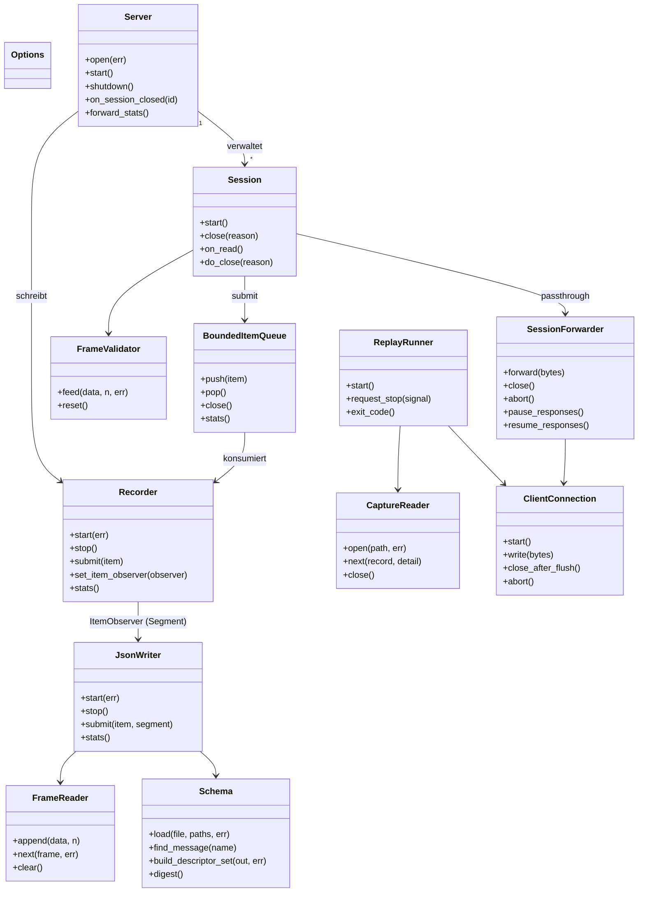

### 5.5 Traceability: Anforderungen → Bausteine

| Anforderung | Hauptbausteine |
|-------------|----------------|
| FR-01 | `Server`, `Session` |
| FR-02 | `Recorder`, `CaptureItem`, `BoundedItemQueue`, PCRP-Format |
| FR-03 | `rec::Framing`, `FrameValidator`, `FrameReader` |
| FR-04 | `framer.h` (`kTypedHeaderSize`, `frame_typed_message`) |
| FR-05 | CLI-Parser, `resolve_type_map`, `JsonWriterConfig` |
| FR-06 | `JsonWriter::handle_data`, `emit_unparsed` |
| FR-07 | `options.file_types`, `JsonWriter::emit_blob` |
| FR-08 | `ReplayRunner`, `CaptureReader`, `ClientConnection` |
| FR-09 | `SessionForwarder`, `Session::on_read/on_response` |
| FR-10 | `Recorder::maybe_rotate`, `ItemObserver`, `JsonWriter::ensure_chunk` |
| FR-11 | `CaptureReader`, `scan_capture_file`, `run_inspect` |
| FR-12 | `JsonWriter`, `Schema`, `rec::segment_json_name` |
| FR-13 | `SendSpec`, `Session::schedule_sends` |
| FR-14 | `Dockerfile`, `compose.yaml` |
| FR-15 | `Schema`, `ReplayRunner::validate_schema` |

---

## 6. Laufzeit

### 6.1 Start und Shutdown im Record-Modus

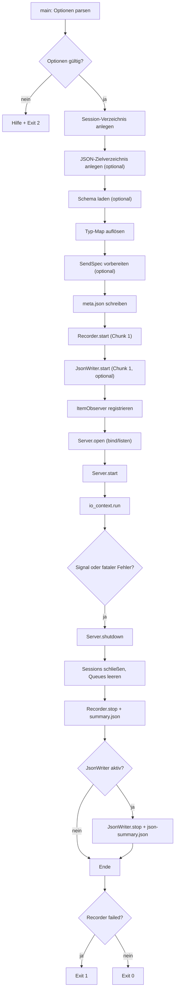

Wichtige Reihenfolgen:

1. `meta.json` wird geschrieben, **bevor** der Server lauscht.
2. Der Recorder ist gestartet, bevor die erste Session Daten liefern kann.
3. Der JsonWriter öffnet Chunk 1 bereits beim Start; der Recorder kennt den
   Observer, bevor die erste Session Items liefert.
4. Beim Shutdown werden zuerst keine neuen Verbindungen mehr angenommen,
   dann Sessions geschlossen, dann Recorder und JSON-Writer beendet.
5. `summary.json` und `json-summary.json` werden erst nach dem Leeren der
   Queues geschrieben.

### 6.2 Record-Pfad (Sequenz)

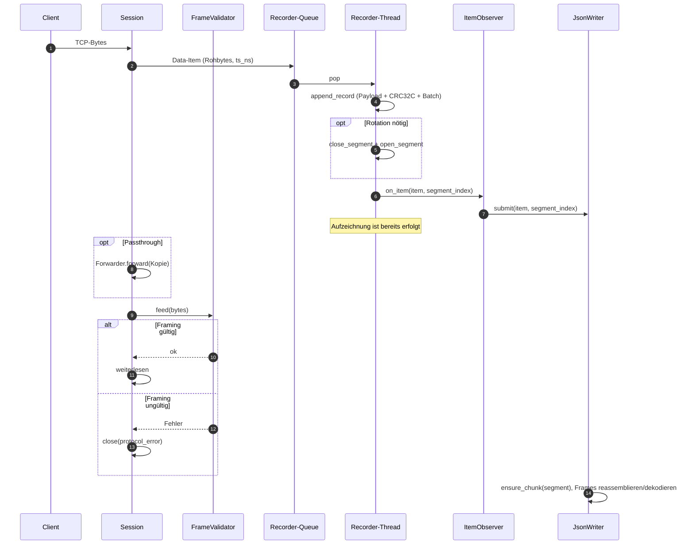

Der Recorder ist autoritativ für die Chunk-Zuordnung: Erst nach dem
erfolgreichen Schreiben meldet er das Item über den `ItemObserver` an den
JsonWriter, zusammen mit dem Segmentindex, in dem der Record gelandet ist.
Der Recorder blockiert bei vollem Puffer gemäß `--overflow`; der JsonWriter
blockiert nie und verwirft bei Überlauf.

### 6.3 JSON-Chunk-Zuordnung

```mermaid
flowchart TD
  A["Recorder: append_record erfolgreich"] --> B["segment_index = aktiver Capture-Chunk"]
  B --> C["ItemObserver(item, segment_index)"]
  C --> D["JsonWriter.submit(item, segment)"]
  D --> E{"segment == aktueller JSON-Chunk?"}
  E -->|ja| F["Events in offene Datei schreiben"]
  E -->|nein| G["close_chunk, dann open_chunk(segment)"]
  G --> G2{"Datei geöffnet?"}
  G2 -->|ja| F
  G2 -->|nein| G3["chunk_open_errors++, Events bis zum nächsten Chunk verwerfen"]
  F --> H["Event mit \"segment\": N"]
```

- Der Recorder rotiert Capture-Chunks nach Zeit und/oder Größe. Der
  Segmentindex wird erst nach `append_record()` ausgelesen, sodass ein Record
  an der Grenze eindeutig dem vollendenden Chunk zugeordnet ist.
- Der JsonWriter rotiert nicht selbst. Er wechselt die Datei genau dann, wenn
  ein Item mit einem anderen Segment eintrifft.
- `seq` zählt global über die Session weiter; `segment` ist pro Event
  redundant zur Datei und erleichtert das Zusammenführen von Chunks.
- Scheitert das Öffnen eines späteren Chunks, läuft die Binäraufnahme weiter;
  `json-summary.json` meldet den Fehler über `chunk_open_errors`. Ein Fehler
  beim Öffnen von Chunk 1 bricht den Start ab.

### 6.4 Verarbeitung eines Typed-Frames im JSON-Writer

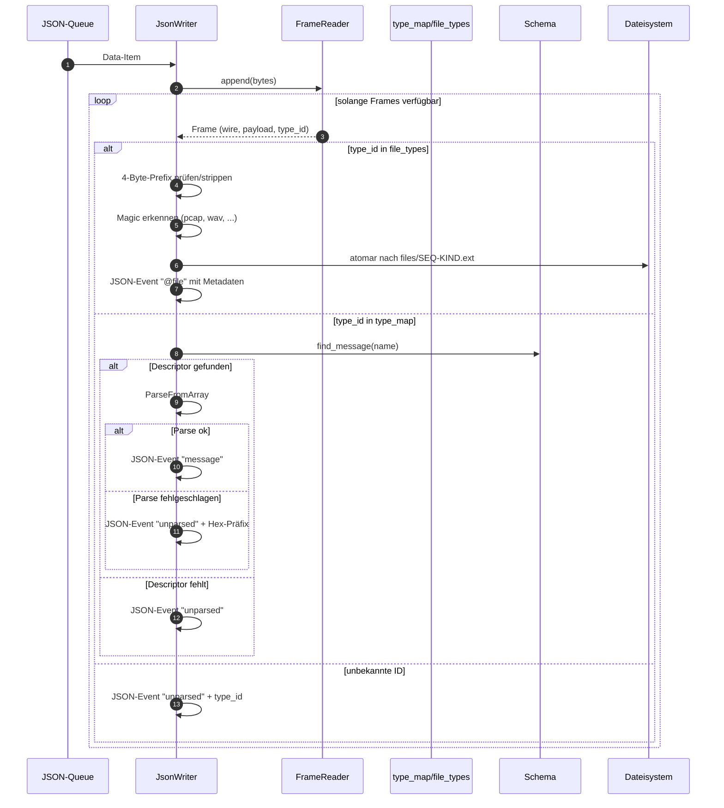

### 6.5 Entscheidungsbaum: Typauflösung

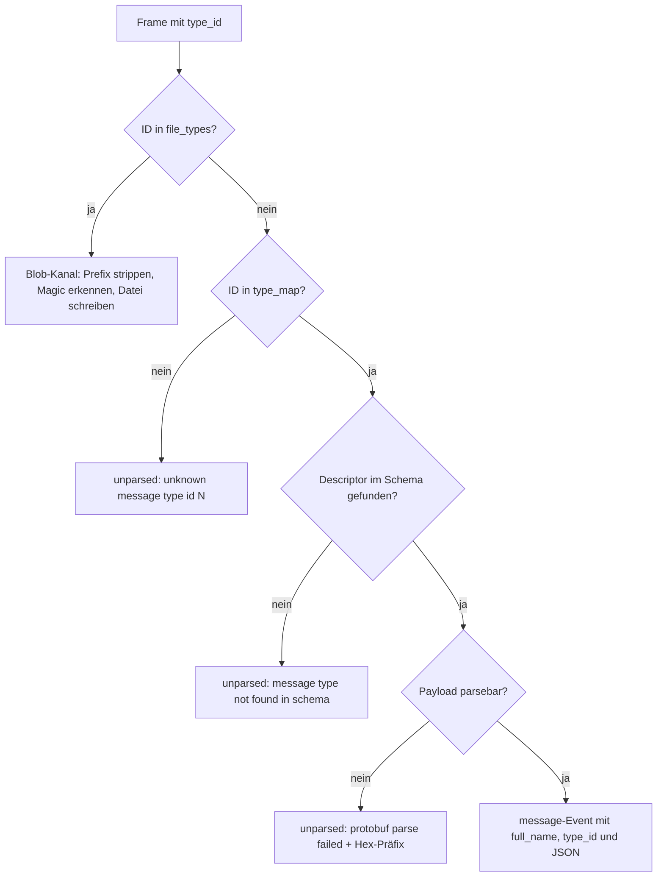

Beim Start werden Typ-Map-Namen bereits aufgelöst:

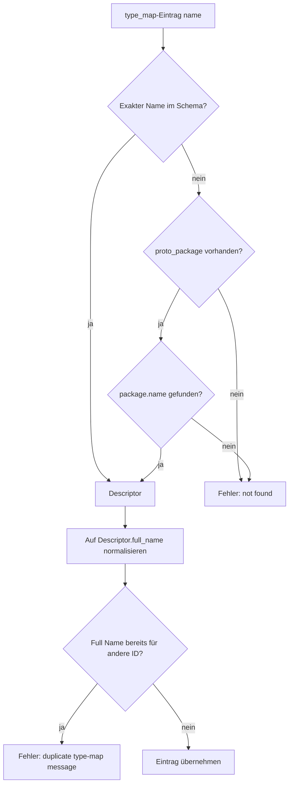

### 6.6 Blob-Extraktion

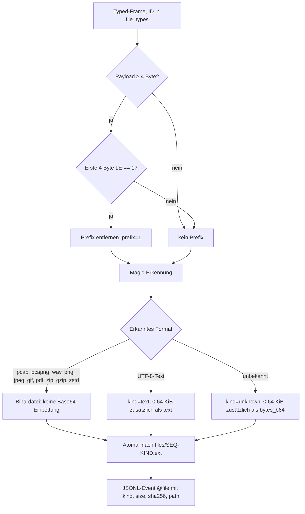

Hinweise:

- `<seq>` ist die globale JSONL-Event-Sequenz, nicht die Wire-Reihenfolge.
- Die Extraktion erfordert `--json`; ohne JSON wird nur eine Warnung geloggt.
- Das optionale 4-Byte-Flag `01 00 00 00` wird nur entfernt, wenn es exakt
  dem Wert `1` entspricht. Ein Blob, der zufällig mit diesen Bytes beginnt,
  würde ebenfalls gekürzt (siehe Risiko R-04).
- Bekannte Binärformate werden nie zusätzlich base64-kodiert, damit das
  Sidecar kompakt bleibt.

### 6.7 Passthrough

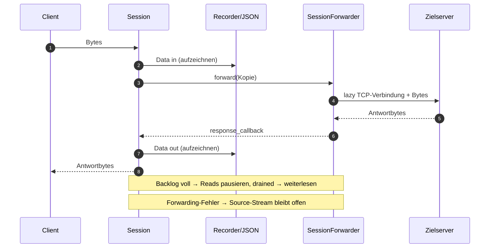

Der Passthrough erzeugt pro Quell-Stream genau eine Zielverbindung. Die
Richtung `in` ist Client → Server, `out` ist Zielserver → Client. Beide
Richtungen landen in derselben Capture-Datei.

### 6.8 Replay und Pacing

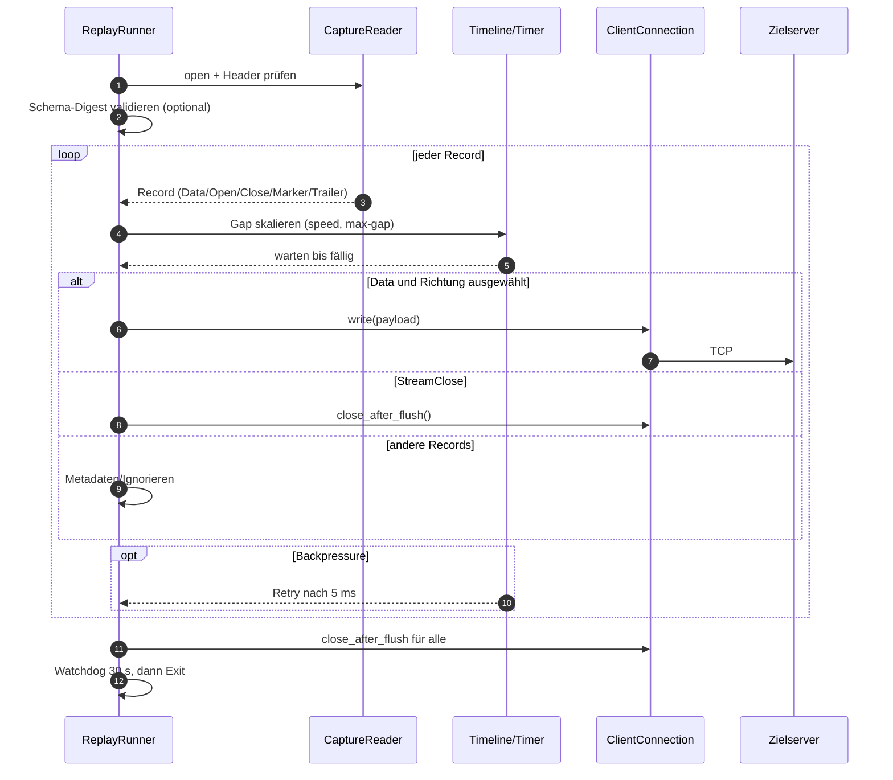

Während der Schleife meldet der Runner den Fortschritt auf `stderr`: voller
Pfad des aktuellen Chunks und Prozent aus
`CaptureReader::bytes_consumed() / file_size()`, gedrosselt auf höchstens alle
100 ms im Terminal (In-Place-Zeile via `\r`) bzw. einmal pro Sekunde bei
zeilenweiser Ausgabe (`--progress line`, `auto` ohne Terminal). Bei `--dir`
steht `[i/N]` davor; Log-Meldungen beenden eine aktive In-Place-Zeile vorher,
am Dateiende wird sie mit `100%` abgeschlossen. `--progress off` deaktiviert
die Meldungen.

Pacing-Regeln:

- Der erste Record wird sofort gesendet.
- Für jeden weiteren Record wird die Differenz der Capture-Zeitstempel durch
  `--speed` geteilt und optional durch `--max-gap` begrenzt.
- `--speed 0` deaktiviert die Verzögerung.
- Chunk-Grenzen erzeugen keine künstlichen Pausen: der Trailer trägt den
  Endzeitstempel des Chunks, Records ohne Wall-Clock-Zeitstempel werden für das
  Pacing ignoriert.
- Bei Rückstau wird die Timeline auf „jetzt“ gesetzt, damit kein Burst
  entsteht.
- Gesamt-High-Water: 64 MiB; pro Stream: 256 MiB.

### 6.9 Entscheidungsbaum: Overflow-Politik

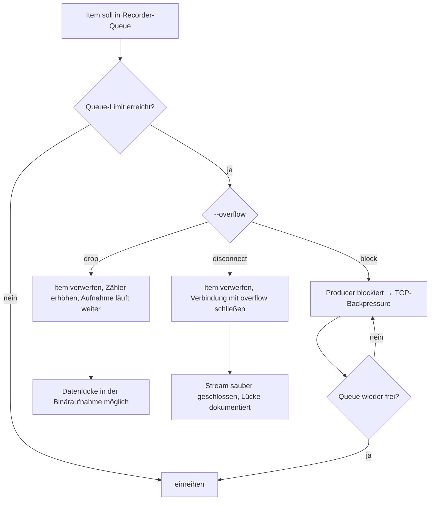

Der JsonWriter verwendet immer `Drop`. Ein verworfener Daten-Item markiert den
Stream als desynchronisiert; bis zum nächsten `stream_open` werden keine
weiteren Frames dieses Streams dekodiert. Die Binäraufnahme bleibt vollständig,
sofern der Recorder nicht ebenfalls verworfen hat.

### 6.10 Entscheidungsbaum: Framing

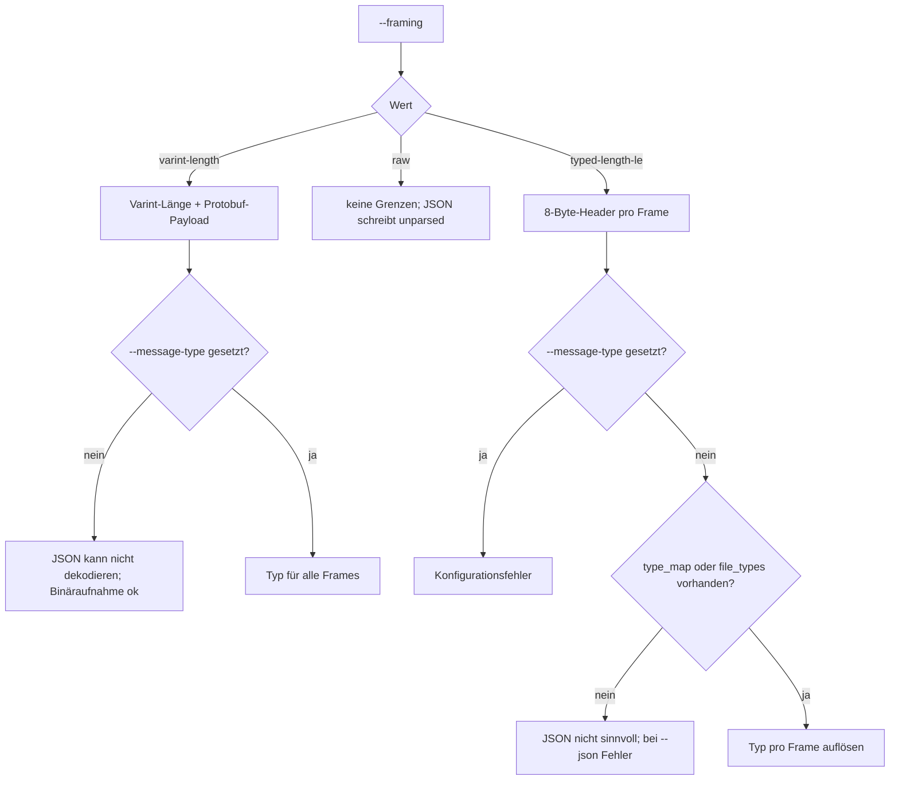

### 6.11 Entscheidungsbaum: Beschädigte Aufnahme

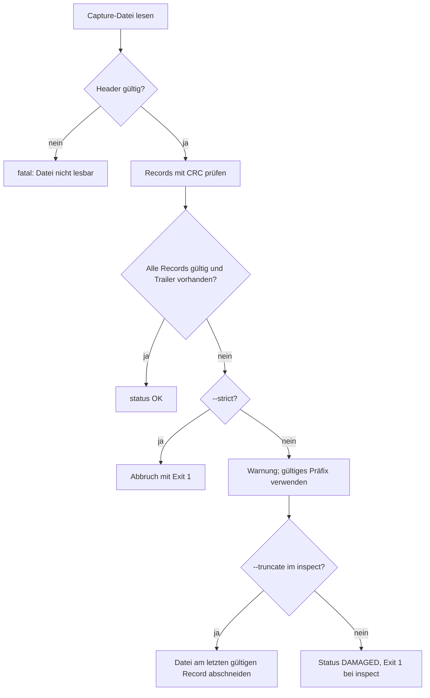

---

## 7. Verteilung

### 7.1 Varianten

| Variante | Voraussetzungen | Start |
|----------|-----------------|-------|
| Lokal (macOS/Linux) | Compiler, CMake, Boost, Protobuf | `./build/default/protorecprep ...` |
| Docker/Compose | Docker Engine + Compose v2 | `docker compose up -d` |

### 7.2 Deployment-Diagramm

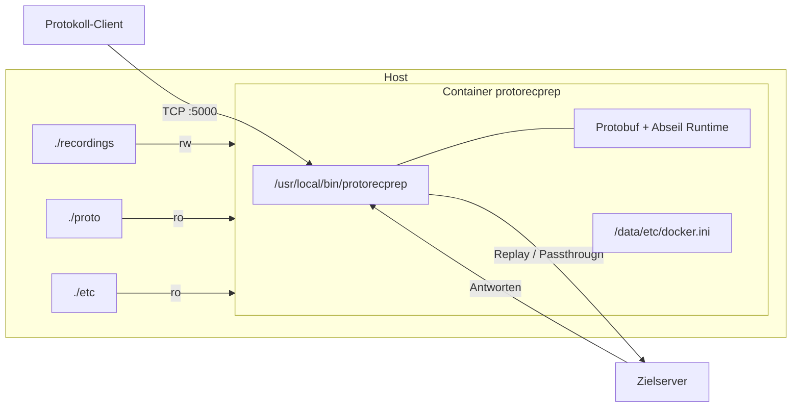

### 7.3 Container-Details

- Multi-Stage-Build: Abseil und Protobuf werden in einer Build-Stage aus
  gepinnten Quellen kompiliert; das Laufzeit-Image enthält nur die
  Bibliotheken und das Binary.
- Standardkommando: `record --config etc/docker.ini`.
- Port: `5000` im Container, Host-Port über `PRP_PORT` konfigurierbar.
- Volumes: `recordings` (rw), `proto` (ro), `etc` (ro).
- `stop_grace_period: 15s` gibt dem Recorder Zeit, Trailer und Summaries zu
  schreiben.
- `extra_hosts: host.docker.internal:host-gateway` macht den Host auch unter
  Linux erreichbar.

Weitere Details: [`docker.md`](docker.md).

### 7.4 Ressourcen und Skalierung

| Ressource | Standard | Hinweis |
|-----------|----------|---------|
| IO-Threads | min(4, Hardware) | `--io-threads` |
| Verbindungen | 1024 | `--max-connections` |
| Empfangspuffer | 256 KiB | `--recv-buffer` |
| Capture-Queue | 256 MiB | `--queue-high-water` |
| JSON-Queue | 64 MiB | intern; Drop-Politik |
| Max. Frame | 16 MiB | `--max-frame` |
| Chunk-Größe | unbegrenzt | `--rotate-size` |
| Chunk-Intervall | 1 min | `--rotate-interval` |

Die Anwendung skaliert vertikal über IO-Threads. Eine horizontale Skalierung
erfolgt über mehrere Instanzen mit getrennten Ports und Ausgabeverzeichnissen.

### 7.5 Betrieb und Überwachung

- Logs gehen auf stderr; Level über `--log-level`.
- `summary.json` und `json-summary.json` liefern maschinenlesbare Zähler.
- `inspect` prüft Dateien ohne sie zu verändern.
- Sauberes Beenden über `SIGINT`/`SIGTERM`.
- Exit-Codes erlauben einfache Health-Checks in Skripten.

---

## 8. Querschnittliche Konzepte

### 8.1 Nebenläufigkeit und Threading

| Thread | Anzahl | Aufgaben | Geteilter Zustand |
|--------|--------|----------|-------------------|
| IO-Threads | 1–4 (Default min(4, HW)) | Asio-Events, Sessions, Server | `Server`, `Session`-Strands |
| Recorder-Thread | 1 | Datei schreiben, CRC, Rotation, fsync | Recorder-Queue, `fd_` |
| JSON-Thread | 0–1 | Dekodieren, Blobs, JSONL | JSON-Queue, Stream-State |
| Replay | IO-Threads | Timeline, Clients | `ReplayRunner`-Strand |

Regeln:

- Jede Session hat einen Strand; alle Socket-Callbacks werden darauf
  ausgeführt.
- Recorder- und JSON-Zustand werden nur von ihren jeweiligen Threads
  berührt.
- Der Recorder ruft den `ItemObserver` nach dem Schreiben aus seinem
  Writer-Thread auf; der Callback reicht das Item nur in die JSON-Queue.
- `CaptureItem` ist nach dem Submit unveränderlich.
- Statistiken sind atomar; Metriken werden ohne Sperren gelesen.

### 8.2 Speicher und Ownership

- `ItemPtr = std::shared_ptr<CaptureItem>`; die letzte Referenz gibt den
  Speicher frei.
- Queues besitzen die Items zwischen Producer und Consumer.
- `CaptureRecord` im Replay ist ein Wertobjekt mit eigenem `data`-Vektor.
- Puffer werden wiederverwendet (`payload_`, `batch_`, `buffer_`), um
  Allokationen auf dem heißen Pfad zu reduzieren.
- Der JSON-Writer hält pro Stream und Richtung einen `FrameReader` und
  wiederverwendete `Message`-Objekte.

### 8.3 Backpressure und Overflow

| Ebene | Mechanismus | Verhalten |
|-------|-------------|-----------|
| TCP → Session | begrenzter Read-Puffer | natürliche Flusskontrolle |
| Session → Recorder | `BoundedItemQueue` | `block`, `drop` oder `disconnect` |
| Session → Forwarder | `forward.queue_limit` | Reads pausieren, `drained` setzt fort |
| Forwarder → Client | Write-Queue | Ziel-Reads pausieren |
| Session → JSON | eigene Queue, immer Drop | Stream wird desynchronisiert |

Ziel: Der Speicherbedarf ist durch Konfiguration begrenzt; die Aufnahme
verliert bei `block` keine Bytes.

### 8.4 Fehlerbehandlung und Exit-Codes

| Situation | Verhalten | Exit |
|-----------|-----------|------|
| Ungültige CLI/INI | Hilfe + Fehlermeldung | 2 |
| Schema nicht ladbar | Fehler vor dem Start | 2 |
| Typ-Map-Name unbekannt | Fehler vor dem Start | 2 |
| Bind fehlgeschlagen | Fehler vor dem Start | 2 |
| Protokollfehler im Stream | Stream schließen, Aufnahme fortsetzen | 0 |
| Unbekannte Typ-ID | `unparsed`, Stream bleibt offen | 0 |
| JSON-Queue voll | Items verwerfen, Stream desynchronisieren | 0 |
| Öffnen eines JSON-Chunks fehlgeschlagen | Warnung, `chunk_open_errors` erhöhen, Aufnahme fortsetzen | 0 |
| Forwarding-Fehler | Warnung, Source-Stream bleibt offen | 0 |
| Fataler Schreibfehler | Shutdown, `summary.json` mit Fehler | 1 |
| Replay: beschädigte Datei | Warnung + gültiges Präfix (oder Abbruch mit `--strict`) | 0/1 |
| Replay: Verbindungsfehler | Retry/Reconnect oder Abbruch | 1 |
| Inspect: beschädigt, ohne `--truncate` | Status `DAMAGED` | 1 |
| Inspect: Reparatur erfolgreich | Status OK | 0 |

### 8.5 Persistenz und Datenintegrität

**PCRP-Dateiformat:**

- Magic `PCRP`, Version `1`.
- Header: 76 Byte fix + Descriptor-Set + CRC32C.
- Header-Felder: Flags, Session-UUID, Framing-Byte, Startzeit, SHA-256 des
  Hauptschemas, Länge des Descriptor-Sets.
- Datensatz-Präfix: 9 Byte (`u8` Typ, `u32` LE Länge, `u32` LE CRC32C).
- Record-Typen: `StreamOpen=1`, `Data=2`, `StreamClose=3`, `Marker=4`,
  `Trailer=5`.
- `Data`-Payload: 16 Byte Fixteil (`stream_id`, Richtung, Padding,
  Zeitstempel) + Rohbytes.
- `Trailer`: Record-/Byte-Zähler, Clean-Flag, Endzeit.
- Chunks: `capture-000001.pcr`, `capture-000002.pcr`, …

**Dauerhaftigkeit:**

- Schreiben in Batches (`--write-batch`, Default 1 MiB).
- `fsync` standardmäßig jede Sekunde; `--fsync-interval 0` deaktiviert die
  periodische Synchronisation.
- `--durable` nutzt auf macOS `F_FULLFSYNC`.
- Jedes Segment wird mit `fsync` geschlossen.
- Blobs und JSON-Summaries werden atomar geschrieben (temporäre Datei +
  Rename).

**Validierung:**

- CRC32C pro Datensatz.
- CRC32C über den Datei-Header.
- Trailer als Marker für sauberes Ende.
- Schema-Digest beim Replay optional.
- `inspect` prüft Header, Records, CRC und Trailer.

### 8.6 Zeit

| Zeitart | Verwendung |
|---------|------------|
| Wall-Clock (`now_wall_ns`) | Zeitstempel in Capture, Metadaten, Session-Namen |
| Monoton (`now_monotonic_ns`) | Pacing, Timer, Laufzeitmessung |
| `steady_clock` | Rotation und fsync-Intervalle |

Wall-Clock-Zeitstempel können springen; das Replay behandelt negative Gaps als
0 und begrenzt die Timeline nach Rückstau.

### 8.7 Konfiguration

Priorität: **CLI > INI > Defaults**. Die INI wird zuerst geparst, dann werden
die CLI-Argumente angewendet. Wiederholbare Optionen akkumulieren. Relative
Pfade beziehen sich auf das Arbeitsverzeichnis. `--config` ist nur einmal
erlaubt.

### 8.8 Logging und Observability

- Level: `debug`, `info`, `warn`, `error`.
- Ausgabe auf stderr, damit stdout für `inspect`-Berichte frei bleibt.
- Zentrale Ereignisse: Start/Ende, Session accepted/closed, Queue-Overflow,
  JSON-Drops, Blob-Schreibfehler, Replay-Statistik.
- JSONL-Events: `stream_open`, `message`, `unparsed`, `@file`,
  `stream_close`, `marker`; jedes Event enthält `seq` und `segment`.
- Summary-Dateien: `summary.json`, `json-summary.json` (inkl.
  `chunks_written`, `chunk_open_errors`, `chunks[]`), `meta.json`.

### 8.9 Sicherheit

- Keine Authentifizierung, keine Verschlüsselung; das Tool ist für vertrauenswürdige
  Netze gedacht.
- Der Listener bindet standardmäßig auf `0.0.0.0`; für lokale Tests
  `127.0.0.1` verwenden.
- Container läuft standardmäßig als `root`; für Host-UID-Betrieb siehe
  `docker.md`.
- Blob-Dateinamen werden aus Sequenz und erkanntem Typ gebildet, nicht aus
  Nutzereingaben; Pfad-Traversal ist dadurch nicht möglich.
- Der Zielserver im Passthrough sollte nicht auf den eigenen Listener zeigen
  (Konfigurationsprüfung).
- Schema-Dateien werden über libprotoc geladen; fehlerhafte Schemas führen zu
  Exit 2.

### 8.10 Zeichenkodierung und JSON

- JSONL ist UTF-8.
- Text-Blobs werden nur eingebettet, wenn sie gültiges UTF-8 sind.
- Binärdaten werden als Base64 eingebettet, aber nur bei `unknown` und
  höchstens 64 KiB.
- `--json-preserve-names` erhält `snake_case`-Feldnamen.
- `--json-print-defaults` gibt auch Felder ohne Präsenz aus.

### 8.11 Teststrategie

| Test | Schwerpunkt |
|------|-------------|
| `unit` | Queue, CRC32C, Recorder/Reader, Options, Framing, Namenshelfer, JSON/Blob, Chunkrotation, Observer |
| `integration` | Record mit Varint, JSONL-Chunks, `segment`-Feld, Einzeldatei-Modus, Chunking |
| `replay` | Byte-genaues Replay, Pacing, Richtungen, Fehlerfälle |
| `passthrough` | Beide Richtungen inkl. Aufzeichnung und JSON-Chunks |
| `typed` | 8-Byte-Header, Typ-Map, unbekannte IDs, Blobs, JSON-Chunks |

Zusätzlich: reale Referenzdaten in `tests/events.jsonl`, Benchmark über
`bench/benchmark.py`, Sanitizer-Presets (`asan`, `tsan`).

### 8.12 Build und Abhängigkeiten

- CMake-Presets: `default`, `debug`, `asan`, `tsan`.
- Optionen: `PRP_BUILD_TESTS`, `PRP_ASAN`, `PRP_TSAN`.
- Bibliotheksziel `prp_core` bündelt die gesamte Anwendungslogik; das Binary
  ist ein dünner Wrapper.
- Docker pinnt Abseil und Protobuf, um reproduzierbare Builds zu ermöglichen.

### 8.13 Kompatibilität und Versionierung

- Das Capture-Format hat eine eigene Version; Leser akzeptieren Version 1.
- Das Framing-Byte ist Teil des Headers; `TypedLengthLE` belegt den Wert 2.
- Neue Felder müssen rückwärtskompatibel ergänzt werden.
- Das Wire-Protokoll ist unverändert: 8-Byte-Header, Little-Endian.
- Ein Schema-Wechsel ändert den Digest und wird beim Replay erkannt.

---

## 9. Architekturentscheidungen

### ADR-01: Binäraufnahme als maßgebliche Wahrheit

- **Kontext:** JSON-Dekodierung kann fehlschlagen, Queues können überlaufen.
- **Entscheidung:** Die Binäraufnahme wird vor jeder Interpretation erstellt;
  JSON ist ein optionales Sidecar.
- **Folgen:** Replay bleibt exakt; JSON-Fehler sind diagnostizierbar, ohne die
  Aufnahme zu gefährden.
- **Alternativen:** JSON als primäre Quelle (verworfen: verlustbehaftet).

### ADR-02: Eigenes PCRP-Format statt pcap

- **Kontext:** Beliebige Protobuf-Ströme mit Verbindungsmetadaten,
  Zeitstempeln und Schema-Bezug.
- **Entscheidung:** Versioniertes Binärformat mit Magic, Header-CRC,
  Datensatz-CRC und Trailer.
- **Folgen:** Werkzeuge müssen das Format kennen; dafür sind Semantik und
  Integrität klar definiert.
- **Alternativen:** pcap/pcapng (verworfen: keine Stream-Metadaten, keine
  Schema-Information), SQLite (verworfen: zusätzliche Abhängigkeit).

### ADR-03: 8-Byte-Header mit expliziter Typ-Map

- **Kontext:** Nachrichten verschiedener Typen teilen sich eine Verbindung.
- **Entscheidung:** `u32` Typ-ID + `u32` Länge; Zuordnung ausschließlich über
  `type_map`.
- **Folgen:** Keine Heuristik, keine falschen Interpretationen; unbekannte IDs
  bleiben sichtbar.
- **Alternativen:** Automatische Erkennung (verworfen: mehrdeutig),
  Self-Describing Protobuf (verworfen: nicht wire-kompatibel).

### ADR-04: Blob-Kanäle als Dateien

- **Kontext:** Große Binärdateien (pcap, WAV) würden JSONL aufblähen.
- **Entscheidung:** `@file`/`@blob`-IDs werden als Dateien extrahiert; JSON
  enthält nur Metadaten.
- **Folgen:** Sidecar bleibt kompakt; Dateien sind direkt nutzbar.
- **Alternativen:** Base64 in JSON (verworfen: Größe/Performance),
  externe Objektspeicherung (verworfen: zusätzliche Infrastruktur).

### ADR-05: Bounded Queue mit wählbarer Overflow-Politik

- **Kontext:** Speicher ist endlich; Aufnahme darf nicht unbemerkt Bytes
  verlieren.
- **Entscheidung:** Standard `block` (TCP-Backpressure), alternativ `drop`
  und `disconnect`.
- **Folgen:** Betreiber entscheidet zwischen Latenz und Verlustfreiheit.
- **Alternativen:** Unbegrenzte Queue (verworfen: OOM-Risiko).

### ADR-06: Single-Writer-Thread für Datei-I/O

- **Kontext:** Parallele Schreibzugriffe erschweren Konsistenz und
  Fehlerbehandlung.
- **Entscheidung:** Nur der Recorder-Thread schreibt; Producer enqueuen.
- **Folgen:** Einfache Invarianten, gute Batch-Performance.
- **Alternativen:** Direktes Schreiben pro Session (verworfen: Sperren,
  Interleaving).

### ADR-07: JSON-Writer blockiert nie

- **Kontext:** Langsame JSON-Verarbeitung darf den Capture-Pfad nicht
  ausbremsen.
- **Entscheidung:** Eigene Queue mit Drop-Politik und Desync-Markierung.
- **Folgen:** Binäraufnahme bleibt vollständig; JSON kann Lücken haben.
- **Alternativen:** Blockieren (verworfen: beeinflusst Aufnahme).

### ADR-08: Schema-Digest im Capture-Header

- **Kontext:** Replay mit falschem Schema führt zu falscher Interpretation.
- **Entscheidung:** SHA-256 der Hauptdatei plus Descriptor-Set im Header.
- **Folgen:** Frühwarnung beim Replay; `--strict` erzwingt Übereinstimmung.
- **Alternativen:** Kein Digest (verworfene: stille Fehlinterpretation).

### ADR-09: Replay mit monotoner Timeline und Rückstau-Schutz

- **Kontext:** Echtzeit-Replay soll Timing erhalten, aber keine Bursts
  erzeugen.
- **Entscheidung:** Skalierte Gap-Timeline, High-Water-Marks, Resync nach
  Rückstau.
- **Folgen:** Stabileres Verhalten bei langsamen Zielen.
- **Alternativen:** Feste Sleeps (verworfen: Drift), kein Pacing (verworfen:
  unrealistisch).

### ADR-10: Forwarding isoliert von der Aufzeichnung

- **Kontext:** Passthrough-Ziele können ausfallen.
- **Entscheidung:** Forwarding-Fehler beeinflussen den Source-Stream
  standardmäßig nicht.
- **Folgen:** Aufzeichnung bleibt robust; Weiterleitung ist best effort.
  Optional koppelt `--link-connections` beide Verbindungen: ein Zielausfall
  schließt den Client (`CloseReason::ForwardError`) und beendet interne
  Reconnects, damit der Client die Verbindung sauber neu aufbauen kann.
- **Alternativen:** Kopplung immer aktiv (verworfen: Datenverlust/Verhalten
  ändert sich für bestehende Aufnahmen), Kopplung nur nach erschöpften
  Reconnects (verworfen: kein sofortiger sauberer Neuaufbau).

### ADR-11: Docker baut Abhängigkeiten aus Quellcode

- **Kontext:** Ubuntu-24.04-Protobuf ist zu alt für die JSON-API.
- **Entscheidung:** Abseil und Protobuf im Image aus gepinnten Quellen bauen.
- **Folgen:** Längere Build-Zeit, dafür reproduzierbar und ohne Host-Setup.
- **Alternativen:** Systempakete (verworfen: API fehlt), statischer Build
  (verworfen: nicht nötig).

### ADR-12: Typ-Map-Namen beim Start normalisieren

- **Kontext:** Nutzer schreiben unqualifizierte oder vollqualifizierte Namen.
- **Entscheidung:** Erst exakt, dann mit `proto_package` suchen; auf
  `full_name()` normalisieren; Duplikate ablehnen.
- **Folgen:** Eindeutige Zuordnung und klare Fehler.
- **Alternativen:** Späte Auflösung pro Frame (verworfen: Fehler erst zur
  Laufzeit).

### ADR-13: JSON-Chunks folgen den Capture-Chunks

- **Kontext:** Eine einzige große JSONL-Datei lässt sich nur über Zeitstempel
  den Binär-Chunks zuordnen; bei Rotation entstehen sonst leicht
  Auseinanderlaufen und aufwändige Auswertungen.
- **Entscheidung:** Der Recorder bleibt autoritativ für Chunk-Grenzen und
  meldet jedes geschriebene Item per `ItemObserver` mit seinem Segmentindex an
  den JsonWriter. Dieser öffnet `capture-NNNNNN.jsonl` passend zu
  `capture-NNNNNN.pcr` und schreibt `"segment": N` in jedes Event.
  `--no-json-chunks` bzw. `--json-file` erhalten den Einzeldatei-Modus.
- **Folgen:** Direkte 1:1-Zuordnung ohne Zeitstempel-Heuristik; Shutdown-
  Reihenfolge und Statistik müssen die Chunkliste mitführen. JSON bleibt
  Best-effort, die Binäraufnahme unverändert Wahrheit.
- **Alternativen:** Unabhängige JSON-Rotation (verworfen: driftet und
  widerspricht der Recorder-Autorität), nur Einzeldatei (verworfen:
  schlechtere Zuordnung bei langen Sessions).

---

## 10. Qualitätsanforderungen

### 10.1 Qualitätsbaum

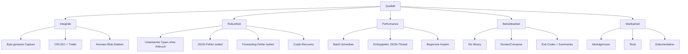

### 10.2 Qualitätsszenarien

| ID | Szenario | Erwartung | Prüfung |
|----|----------|-----------|---------|
| QS-01 | Client sendet 10 Minuten Daten mit 100 Mbit/s | Keine Bytes fehlen bei `--overflow block` | Benchmark + Replay-Vergleich |
| QS-02 | Frame hat unbekannte Typ-ID | Verbindung bleibt, `unparsed` mit ID | `typed`-Test |
| QS-03 | JSON-Queue läuft voll | Binäraufnahme vollständig, JSON-Lücke dokumentiert | Unit-/Lasttest |
| QS-04 | Prozess wird mit `SIGTERM` beendet | Trailer + Summaries geschrieben | Integrationstest |
| QS-05 | Stromausfall mitten im Schreiben | `inspect` erkennt Tail, `--truncate` repariert | Recovery-Test |
| QS-06 | Replay mit falschem Schema | Warnung oder Abbruch mit `--strict` | `replay`-Test |
| QS-07 | Zielserver im Passthrough nicht erreichbar | Ohne `--link-connections` läuft die Aufzeichnung weiter; mit Kopplung wird der Client getrennt | `passthrough`-Test |
| QS-08 | Reale Blob-Aufnahme mit 103 Frames | 59 pcap, 32 wav, 12 text, byte-genau | `tests/events.jsonl` |
| QS-09 | Containerstart ohne Host-Protobuf | App läuft | `docker compose up` |
| QS-10 | 1 GiB Daten, 1 MiB Batch | Stabiler Durchsatz, begrenzter Speicher | Benchmark |
| QS-11 | Session rotiert in mehrere Capture-Chunks | Gleichnamige JSONL-Chunks, jedes Event mit korrektem `segment` | `integration`-/`typed`-Test, Unit-Chunkrotation |

### 10.3 Messbare Zielgrößen

| Größe | Ziel |
|-------|------|
| Datenverlust bei `block` | 0 Bytes |
| JSON-Overhead | < 2× Binärdurchsatz (benchmarkabhängig) |
| Speicherverbrauch | durch Queue-Limits begrenzt |
| Recovery | jede abgeschnittene Datei bis zum letzten gültigen Record reparierbar |
| Blob-Trefferquote | alle bekannten Magic-Formate erkannt |

---

## 11. Risiken und technische Schulden

| ID | Risiko/Schuld | Auswirkung | Gegenmaßnahme |
|----|---------------|------------|---------------|
| R-01 | Docker-Build nicht lokal verifiziert | Image könnte auf anderer Plattform scheitern | Nutzer-Test mit `docker compose build` und `ldd` |
| R-02 | Kein Windows-Support | POSIX-APIs fehlen | Dokumentiert; Portierung wäre eigener Aufwand |
| R-03 | Keine Authentifizierung/Verschlüsselung | Offener Listener missbrauchbar | Nur vertrauenswürdige Netze; Firewall |
| R-04 | 4-Byte-Prefix-Heuristik bei Blobs | Legitime Blobs mit `01 00 00 00` werden gekürzt | Bewusste Protokollannahme; im JSON als `prefix` sichtbar |
| R-05 | JSON-Desync nach Queue-Overflow | Sidecar unvollständig | `json-summary.json` zählt Drops; Binäraufnahme bleibt Wahrheit |
| R-06 | Schema-Digest nur der Hauptdatei | Änderung einer importierten Datei wird nicht erkannt | Dokumentiert; Descriptor-Set im Capture enthält Abhängigkeiten |
| R-07 | `type_map` ist manuell | Falsche ID → falsche Interpretation | Beim Start validieren; unbekannte IDs bleiben `unparsed` |
| R-08 | Kein Lizenztext | Rechtliche Unsicherheit | Mit Autor klären |
| R-09 | Replay-Pacing hängt von Wall-Clock-Daten ab | Springende Uhren können Timeline verzerren | Negative Gaps = 0, Resync nach Rückstau |
| R-10 | Blob-Extraktion nur mit `--json` | Ohne JSON keine Dateien | Warnung beim Start; dokumentiert |
| R-11 | `tests/__pycache__` versioniert | Rauschen im Diff | Bei Bedarf entfernen und `.gitignore` konsequent nutzen |
| R-12 | Docker läuft als root | Dateien gehören root | `PRP_UID`/`PRP_GID`-Hinweis in `docker.md` |
| R-13 | JSON-Chunk kann nicht geöffnet werden | JSONL-Lücke für dieses Segment | `chunk_open_errors` in `json-summary.json`; Binäraufnahme läuft weiter |

---

## 12. Glossar

| Begriff | Bedeutung |
|---------|-----------|
| **arc42** | Strukturvorlage für Software-Architekturdokumentation |
| **Backpressure** | Rückstau, der Producer bremst, statt Speicher unbegrenzt zu füllen |
| **Blob** | Vollständige Datei in einem Typed-Frame, z. B. pcap oder WAV |
| **Capture** | Binäraufnahme im PCRP-Format (`.pcr`) |
| **Chunk/Segment** | Einzelne Capture-Datei bei Rotation; JSON-Chunks spiegeln sie als `capture-NNNNNN.jsonl` |
| **CRC32C** | Prüfsummenverfahren für Datensatzintegrität |
| **Desync** | Zustand, in dem das JSON-Sidecar keine gültigen Frames mehr reassemblieren kann |
| **Framing** | Art der Nachrichtengrenzen auf dem Wire |
| **Frame** | Eine complete Nachricht inkl. Framing-Header |
| **High-Water-Mark** | Schwellwert, ab dem Replay oder Forwarding bremst |
| **JSONL** | Zeilenorientiertes JSON, eine Event pro Zeile |
| **Passthrough** | Live-Weiterleitung mit gleichzeitiger Aufzeichnung |
| **PCRP** | Magic des protorecprep-Capture-Formats |
| **Pacing** | Zeitliche Steuerung des Replays |
| **Replay** | Byte-genaues Zurückspielen einer Aufnahme |
| **Session** | Ein Aufzeichnungslauf mit eigenem Verzeichnis und eigener UUID |
| **Strand** | Asio-Ausführungskontext, der Handler serialisiert |
| **Trailer** | Abschlussdatensatz einer sauberen Capture-Datei |
| **type_map** | Manuelle Zuordnung von Wire-Typ-IDs zu Protobuf-Nachrichten oder `@file` |
| **Typed-Length-LE** | 8-Byte-Header: Typ-ID und Länge, Little-Endian |

---

## Anhang A: Verwandte Dokumente

- [`README.md`](../README.md) – Benutzerhandbuch, CLI-Referenz, Schnellstart
- [`docker.md`](docker.md) – Container-Betrieb, Multi-Arch, Bibliotheksprüfung
- [`requirements.txt`](requirements.txt) – Anforderungsnotizen
- `etc/*.ini` – kommentierte Beispielkonfigurationen
- `proto/sample.proto` – Beispielschema für Tests und Beispiele

## Anhang B: Pflege dieses Dokuments

Dieses Dokument soll bei folgenden Änderungen aktualisiert werden:

- neue CLI-Optionen oder geänderte Defaults,
- Änderungen am Wire-Framing oder am `.pcr`-Format,
- neue Bausteine oder verschobene Verantwortlichkeiten,
- geänderte Overflow-, Replay- oder Blob-Strategien,
- neue Deployment-Varianten.

Die Mermaid-Diagramme sind textuelle Quellen und können in GitHub, GitLab
oder jedem Mermaid-fähigen Renderer angezeigt werden.
